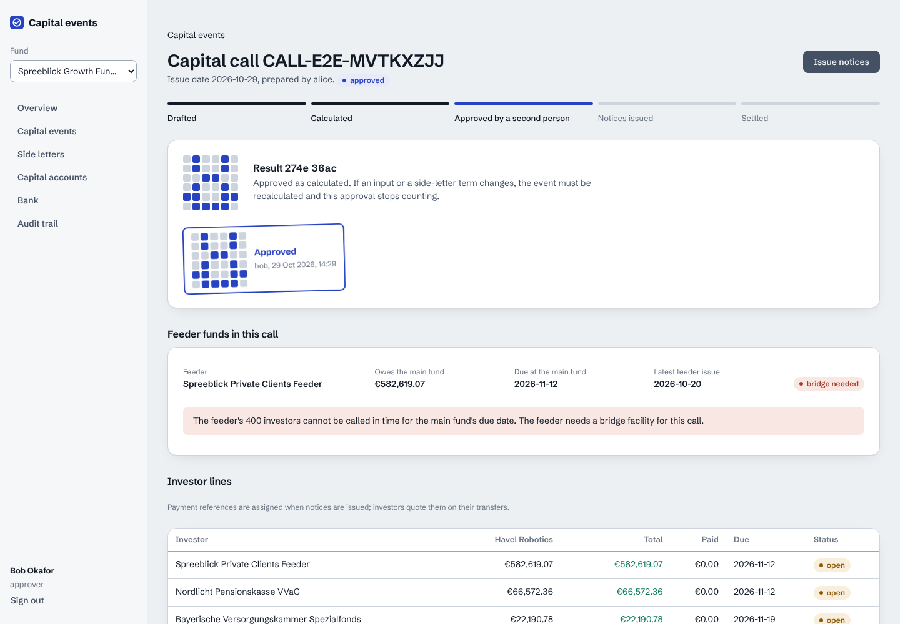

# capital-events-engine

Capital calls, subsequent closings with equalisation, distributions through a European
waterfall, feeder funds and side letters, for a fund administrator that runs many funds with
thousands of LPs each. Every amount is exact, every result is approved by a second person
against its fingerprint before an investor sees it, and every cent lands in a double-entry
ledger that a bank statement can be reconciled against.

The stack is the one a private-markets platform team would run: **TypeScript, NestJS 12 on
Fastify, MySQL 8.4 through Kysely, a React 19 console, Kubernetes on AWS** (Helm, Terraform for
EKS and RDS).



## Why this problem

A capital call looks like arithmetic and is not. Pro-rata by commitment, except investors excused
from the deal's sector, whose share is spread over the others without pushing anyone past their
unfunded commitment. Management fees switch basis at the end of the investment period, part-way
through a fee period, on ACT/365. Side letters change fees, notice periods and carry per investor,
and an MFN clause lets an investor elect terms granted to others. A subsequent closing makes new
investors catch up on every earlier call, with interest, and refunds the existing ones. A
distribution runs through return of capital, a compounded preferred return, a GP catch-up and an
80/20 split. A feeder fund has to call its own investors early enough to pay the main fund.

Done in spreadsheets, each of these is a place where one cent goes missing or one investor gets a
wrong notice. The engineering questions are the ones that matter in a regulated product: how do
you know the numbers are right, how do you stop a wrong number reaching an investor, and how does
it hold up at 5,000 LPs per fund.

## What was measured

| Claim | Evidence |
|---|---|
| The calculations are right | **36,000 generated scenarios, 0 differences** between the TypeScript engine and an independent Python reference written blind from [`docs/SPEC.md`](docs/SPEC.md) (6,000 committed in `reports/differential/`, 30,000 more in every CI run with a new seed). See [docs/DIFFERENTIAL.md](docs/DIFFERENTIAL.md). |
| A wrong number cannot reach an investor | Approval is bound to the result's SHA-256. Recalculating after any change voids earlier approvals; the preparer cannot approve their own event; issuing recalculates under a lock on the fund and refuses if the hash differs from the one approved. Covered by API tests and the Playwright four-eyes run. |
| It holds up at 5,000 LPs | Reconciling a 5,000-credit camt.054 statement: **40.1 s → 1.27 s** after moving per-row round trips to set-based SQL. Issuing a call: 4.3 s → 1.2 s. See [docs/PERFORMANCE.md](docs/PERFORMANCE.md). |
| The speed-up did not change the books | The benchmark counts ledger postings: the first batched version made 69,003 instead of 74,002, because it collapsed bank lines. Found, fixed, and pinned by a test. Postings are 74,002 again. |
| Side-letter extraction, honestly | On 28 letters written blind (66 terms), the rules extractor finds **55% of terms at 71% precision**. That is why every extracted term is a proposal a second person approves against the sentence it came from. The Claude extractor is built but has not been scored. |

## How it fits together

```
 console (React 19)  ──►  API (NestJS 12 / Fastify)  ──►  MySQL 8.4
   sign-in, events,        auth: JWT (JWKS in prod)        tenant-guarded queries
   side letters,           tenancy guard on every query    double-entry ledger (immutable)
   bank, audit             engine: exact arithmetic        hash-chained audit (immutable)
                           outbox worker (SKIP LOCKED)     outbox, idempotency keys
                           ISO 20022 pain.001 / camt.054
```

- **`packages/engine`**: pure functions over exact rationals (BigInt). TARGET2 business days,
  largest-remainder allocation, excuse rights with water-filling, fee basis switch, equalisation,
  the waterfall, feeder pass-through and MFN eligibility. No I/O.
- **`reference/`**: the same contract in Python, written by someone who saw only the spec. It
  exists to disagree with the engine.
- **`apps/api`**: tenancy is enforced in the query builder (a Kysely plugin refuses any query on a
  tenant table without a tenant filter), approvals and issuing take row locks, the ledger and audit
  log are append-only by database triggers, side effects go through an outbox.
- **`apps/console`**: every screen has a loading skeleton, an error with retry and an empty state.
  The event page shows the result as a fingerprint glyph and the approvals as stamps signed
  against it, so a void approval is visible at a glance.
- **`deploy/`**: Helm chart (migrations as a pre-upgrade hook, zero-unavailable rollouts, network
  policies, read-only root filesystems), Terraform (private EKS, RDS MySQL 8.4 with UTC and
  required TLS, KMS, immutable ECR, GitHub OIDC), and a kind smoke test in CI.

More in [docs/ARCHITECTURE.md](docs/ARCHITECTURE.md) and the decisions in [docs/adr/](docs/adr/).

## Running it

Node 22, pnpm 10, MySQL 8 (or `docker run -e MYSQL_ROOT_PASSWORD=root -p 3306:3306 mysql:8.4`).

```sh
pnpm install
pnpm --filter @cee/engine build && pnpm --filter @cee/api build
cp apps/api/.env.example apps/api/.env && set -a && . apps/api/.env && set +a
pnpm --filter @cee/api migrate && pnpm --filter @cee/api seed   # a manager with 31 + 400 LPs
node apps/api/dist/main.js &                                     # API on :3000
pnpm --filter @cee/console dev                                   # console on :5173
```

Sign in as Alice (prepares), Bob (approves) or Vera (reads). The seed leaves a call waiting for
approval, a call that cannot be calculated, a side letter in review and two bank credits nobody
can place.

## Tests

| Suite | Count | What it covers |
|---|---|---|
| Engine (Vitest, fast-check) | 23 | arithmetic, dates, allocation, each calculation, properties |
| Reference (pytest) | 77 | the blind implementation's own tests |
| Differential | 30,000 per CI run | both implementations on generated scenarios |
| API (Vitest on MySQL) | 33 | lifecycle, four-eyes, stale approvals, reconciliation, tenancy, immutability, time zones, config, OpenAPI drift |
| Console (Vitest, Testing Library) | 16 | role-dependent actions, approving the shown hash, error and retry, quote marking, form validation, CSP parity |
| End to end (Playwright) | 6 | the four-eyes flow across two people, the whole UI under the production CSP, a phone viewport |
| Held-out side letters | 28 letters | scored once, first run pinned (`reports/heldout/`) |

CI ([.github/workflows/ci.yml](.github/workflows/ci.yml)) runs all of it, the API tests against a
MySQL server set to CET, Helm and Terraform validation, and a kind cluster that builds both
images, runs the migration hook, rolls out, seeds and calls the API.

## Limits

- The data is simulated. The fund terms, letters and bank files are realistic in shape, not
  taken from a real administrator.
- The waterfall is European (whole-fund) with one hurdle and an 80/20 split. American
  (deal-by-deal) waterfalls, clawback and multiple hurdles are not modelled.
- One currency per fund; no FX.
- Side-letter extraction by rules finds about half of the terms in unseen letters. The Claude
  extractor has not been scored, because no API key was available while building.
- The Terraform has been validated, not applied: there was no AWS account to apply it to.
- Known shortcuts are listed in [docs/ENGINEERING.md](docs/ENGINEERING.md#technical-debt).
